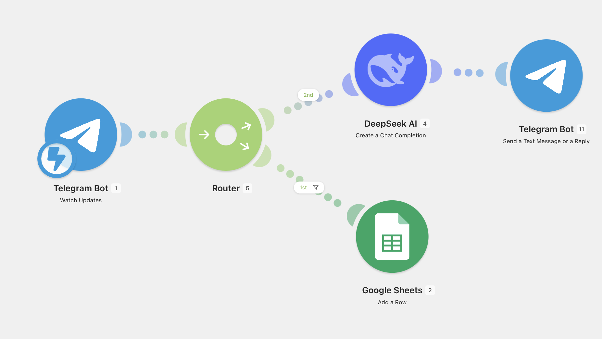

# AI Telegram Assistant

AI Telegram Assistant is a conversational automation project that connects Telegram Bot API with OpenAI through n8n or Make.com. The system receives user messages, applies routing logic, maintains conversation context, and returns AI-generated responses through Telegram.

## Business Problem

Many teams receive repetitive questions through messaging channels. Common requests include basic support questions, lead intake, status checks, service explanations, and internal assistant tasks. Handling these messages manually creates constant context switching and makes it difficult to provide consistent answers.

A simple chatbot is often not enough because real business communication requires routing, context, fallback handling, and integrations with other systems. Without an automation layer, every message is treated as an isolated prompt, which limits reliability and makes the assistant difficult to maintain.

## Solution

This project uses Telegram as the user interface, an automation workflow as the control layer, and OpenAI as the reasoning and response engine. Incoming Telegram messages are parsed, classified, enriched with recent conversation memory, and sent to OpenAI with structured instructions. The response is then returned to the same Telegram chat.

The workflow separates communication from business logic. Telegram handles messaging, OpenAI handles natural language generation, and n8n or Make.com manages routing, memory, API calls, and error handling. This structure makes the assistant easier to extend with databases, CRMs, internal APIs, or human escalation.

## Architecture

```text
Telegram User
  ↓
Telegram Bot API
  ↓
Make.com / n8n
  ↓
Routing Logic
  ↓
Conversation Memory
  ↓
OpenAI
  ↓
Response Formatter
  ↓
Telegram Bot API
```

## Workflow

1. A user sends a message to the Telegram bot.
2. Telegram Bot API forwards the update to the automation workflow.
3. The workflow extracts chat ID, user ID, message text, and message type.
4. Routing logic checks whether the message is a command, normal text, or unsupported content.
5. Recent conversation context is retrieved from the configured memory storage.
6. The workflow builds a prompt with system instructions, conversation context, and the current message.
7. OpenAI generates a response based on the prompt.
8. The automation stores the new exchange for future context.
9. The response is formatted for Telegram.
10. The answer is sent back to the user.
11. Error paths handle API failures, empty responses, unsupported message types, and timeout cases.

## Technologies

| Technology | Purpose |
| --- | --- |
| Telegram Bot API | Messaging interface |
| OpenAI | AI response generation |
| Make.com / n8n | Automation orchestration |
| HTTP Requests | API communication |
| Airtable / Database | Optional conversation memory |
| Conditional Logic | Command and message routing |

## Features

- Telegram-based AI assistant
- Multi-turn conversation memory
- Command handling and fallback routes
- OpenAI-powered responses
- HTTP-based external integrations
- Configurable system prompts
- Error handling for failed AI or Telegram requests
- Extensible structure for CRM, database, or support workflows

## Business Value

The assistant reduces repetitive manual responses and provides a consistent first layer of communication. It can answer routine questions, collect structured information, and route conversations before a human needs to step in.

For small teams, this creates a practical support and intake channel without building a custom application. For technical teams, it provides a reusable architecture for connecting messaging interfaces to AI workflows and business systems.

## Future Improvements

- Add voice message transcription with Whisper
- Store long-term user profiles in a database
- Add human escalation for complex requests
- Implement role-based behavior for different user groups
- Add analytics for conversation volume and common topics
- Include moderation and safety checks before responses are sent

## Repository Structure

```text
AI-Telegram-Assistant/
├── README.md
├── assets/
│   └── workflow.png
└── workflows/
    └── workflow.json
```

## Screenshot



## Export

The workflow export is located inside:

```text
workflows/workflow.json
```

# AI-Telegram-Assistant
